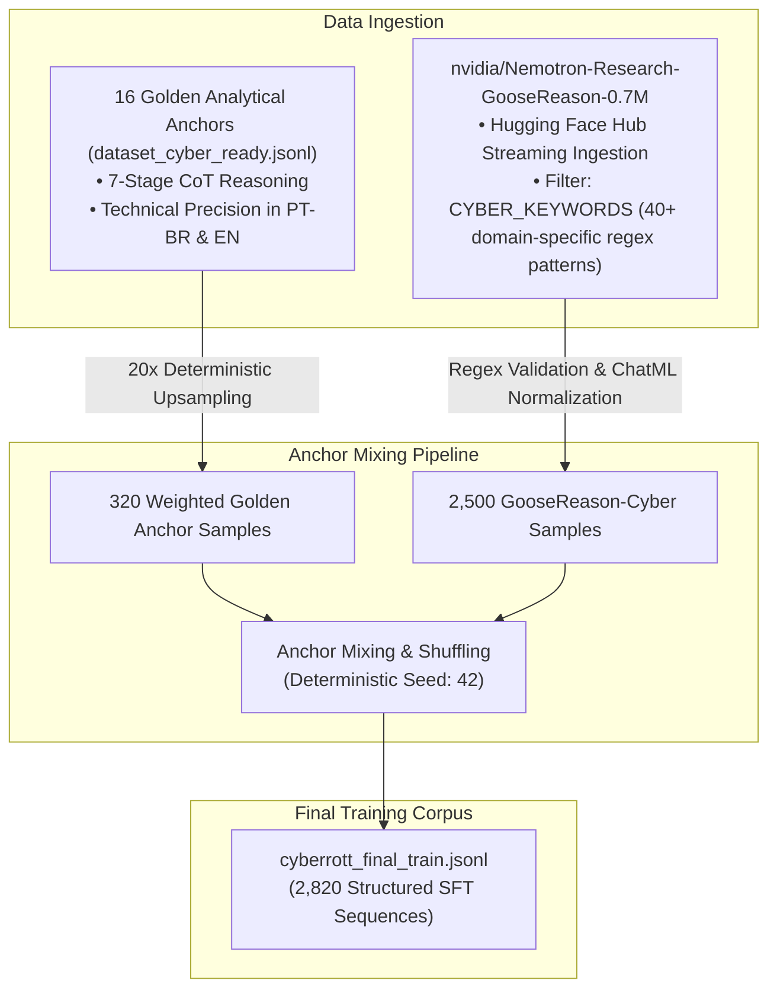

---
language:
- en
- pt
license: mit
base_model: microsoft/Phi-4-mini-instruct
tags:
- cybersecurity
- reasoning
- cot
- chain-of-thought
- slm
- red-team
- blue-team
- vulnerability-analysis
- appsec
- cve
- lora
- wmdp
- wmdp-cyber
datasets:
- nvidia/Nemotron-Research-GooseReason-0.7M
- cais/wmdp
pipeline_tag: text-generation
model-index:
- name: CyberRott-Phi4-mini-Instruct
  results:
  - task:
      type: text-generation
      name: Cybersecurity Question Answering
    dataset:
      name: WMDP-Cyber
      type: cais/wmdp
      args: wmdp-cyber
    metrics:
    - name: WMDP-Cyber (0-shot Loglikelihood)
      type: acc
      value: 43.18
    - name: WMDP-Cyber (0-shot Generative CoT)
      type: acc
      value: 36.08
---

# 🛡️ CyberRott 1.0 — Reasoning-Driven Cybersecurity SLM

**CyberRott 1.0** is a domain-specialized Small Language Model (SLM) operating at **3.82 billion parameters**, architected to advance automated technical analysis across **Offensive Security, Defensive Engineering, and Digital Forensics**. Built upon the dense foundation of **Microsoft Phi-4-mini-instruct**, CyberRott integrates a native **Chain-of-Thought (CoT) Latent Reasoning Engine** encapsulated within explicit `<think>...</think>` tokens. This mechanism forces rigorous, multi-stage decomposition of software security vulnerabilities, network protocols, and operational tradecraft prior to synthesizing the final diagnostic verdict.

The model is the product of an **Anchor Mixing Architecture**, combining large-scale synthetic reasoning trajectories from the [NVIDIA Nemotron Research GooseReason-0.7M](https://huggingface.co/datasets/nvidia/Nemotron-Research-GooseReason-0.7M) dataset with **16 High-Density Golden Analytical Anchors** across English and Portuguese, calibrated across Red Team operations, Blue Team telemetry, DevSecOps, and low-level binary exploitation.

---

## 🎯 Executive Model Summary

| Specification | Technical Configuration |
| :--- | :--- |
| **Base Model** | [`microsoft/Phi-4-mini-instruct`](https://huggingface.co/microsoft/Phi-4-mini-instruct) (3.82B parameters) |
| **Base Architecture** | Dense Transformer Decoder, Rotary Position Embeddings (RoPE), 200,064 token vocabulary |
| **Adaptation Method** | Parameter-Efficient Fine-Tuning (PEFT) via **LoRA** (Low-Rank Adaptation) |
| **LoRA Configuration** | Rank r = 32, Alpha α = 64 (Scaling Factor: 2.0, Dropout: 0.05) |
| **Target Projections** | `all-linear` (`qkv_proj`, `o_proj`, `gate_up_proj`, `down_proj`) |
| **Numerical Precision** | Native Bfloat16 (`bf16`) with PyTorch Scaled Dot-Product Attention (SDPA) |
| **Reasoning Topology** | 7-Stage Structured Chain-of-Thought (CoT) delimited by `<think>...</think>` |
| **Training Corpus** | 2,820 Curated Sequences (320 20x-Upsampled Anchors + 2,500 GooseReason-Cyber samples) |
| **Training Steps / Epochs** | 530 optimization steps across 3 complete epochs |
| **Final Convergence Loss** | **0.2825** (strictly monotonic convergence from an initial ~1.4500) |
| **WMDP-Cyber Benchmark (0-shot)** | **43.18%** (±1.11% stderr, 95% CI: [41.00%, 45.36%]) |
| **License** | MIT License |

---

## 🧠 Analytical Reasoning Topology (7-Stage CoT Protocol)

Unlike standard generative language models that immediately produce terse, hallucination-prone verdicts, **CyberRott 1.0** enforces an internal, non-bypassable deliberation step. Each analysis progresses through seven discrete analytical checkpoints:

```html
<think>
**Surface Analysis**: Deconstruct target software architecture, runtime execution context, and exposed interfaces.
**Entry Point / Attack Vector Identification**: Pinpoint untrusted inputs, network sockets, API parameters, or memory buffers.
**Data Flow / Internal Mechanics (Taint Analysis)**: Trace data propagation through memory and application layers to critical sink interfaces.
**Vulnerable Sink / Control Flaw Detection**: Isolate insecure standard library functions, logic gaps, or authorization bypasses.
**Sanitization and Mitigation Assessment**: Evaluate runtime protections, input filters, firewalls, and OS/compiler mitigations (ASLR, DEP/NX, Stack Canaries).
**Vulnerability Verdict / Anomaly Classification**: Formulate a categorical diagnostic verdict mapped to standard CWE entries and MITRE ATT&CK techniques.
**Potential Impact**: Model realistic adversarial blast radius (RCE, LPE, DoS, Data/Credential Exfiltration).
</think>

FACT: Direct, definitive, and technically grounded security verdict.
DETECTION / TELEMETRY: High-fidelity detection logic (Sigma rules, YARA rules, SIEM queries, EDR event IDs).
REMEDIATION / HARDENING: Production-ready secure code implementations, configuration hardening, and defense-in-depth measures.
```

---

## 📊 Data Methodology & Anchor Mixing

The data preparation pipeline balances high-breadth reasoning diversification with uncompromising technical depth:



### The 16 Golden Anchor Problem Scenarios
1. **SQL Injection (CWE-89)**: UNION-based data extraction, parameter interpolation flaw, parameterized query remediation, and ModSecurity Core Rule Set (CRS 942100) inspection.
2. **Use-After-Free (UAF - CWE-416)**: Dangling heap pointers, double-free mechanics, exploitation pathways, and pointer-nulling remediation.
3. **Integer Overflow & Signedness Mismatch leading to Heap Overflow (CWE-190/195/122)**: Negative signed values cast to unsigned `size_t` allocation parameters, causing undersized buffer allocation and subsequent heap corruptions.
4. **Insecure Object Deserialization (CWE-502)**: Arbitrary bytecode execution via Python `pickle`, gadget chain formation, and safe schema-validated serialization alternatives.
5. **Server-Side Request Forgery (SSRF - CWE-918)**: AWS IMDSv1 cloud metadata credential theft, parser differential bypasses, and transition to IMDSv2 with network token enforcement.
6. **Time-of-Check to Time-of-Use (TOCTOU - CWE-367)**: File system race conditions abusing symlink swaps between validation and write, remediated using atomic file descriptors (`O_NOFOLLOW`).
7. **Kerberos Delegation Abuse (S4U2self / S4U2proxy)**: Protocol transition exploitation, unconstrained delegation abuse, and Windows Event ID 4769 telemetry auditing.
8. **EDR Evasion via Kernel Callbacks & ETW-Ti Blinding**: Telemetry suppression via DKOM patching of `PspCreateProcessNotifyRoutine` and user-mode API hooking bypasses.
9. **Process Hollowing (MITRE T1055.012)**: Legitimate host process suspension, unmapping via `ZwUnmapViewOfSection`, malicious PE injection, thread context redirection, and memory inspection markers.
10. **Format String Vulnerability (CWE-134)**: Arbitrary memory reading (`%x`) and controlled arbitrary memory overwrite (`%n`) with format-safe logging mitigations.
11. **Smart Contract Reentrancy (CWE-841 / SWC-107)**: External fallback invocation before state balance updates; Checks-Effects-Interactions and mutex lock patterns in Solidity.
12. **DNS Tunneling & Data Exfiltration (MITRE T1071.004)**: Base64/Base32 payload chunking across DNS subdomains, detected via Shannon entropy analysis and anomalous RDATA volume metrics.
13. **JWT Algorithm Confusion (RFC 7515 / CVE-2015-9235)**: Public key RS256-to-HS256 asymmetric-to-symmetric substitution bypass, remediated via strict algorithm pinning.
14. **Docker Container Breakout via Privileged Mode**: Abuse of Linux capabilities (`CAP_SYS_ADMIN`), raw block device mounting (`/dev/sda`), and cgroup containment escapes.
15. **AES-GCM Nonce Reuse (CWE-323)**: Cryptographic GHASH authentication key recovery (H) through polynomial factorization, leading to message authentication tag forgery.
16. **Path Traversal & Local File Inclusion (CWE-22)**: URL-encoded traversal sequence bypasses targeting `/etc/passwd`, mitigated with canonicalization checks (`realpath()`) and basename pinning.

---

## 📈 Training Performance and Convergence Metrics

Fine-tuning parameters were rigorously tuned for optimal optimization dynamics:

- **Total Training Duration**: 3 epochs (530 optimization steps)
- **Effective Batch Size**: 16 (2 sequences per device × 8 gradient accumulation steps)
- **Peak Learning Rate**: 2e-4 with Cosine annealing and 5% warmup ratio
- **Optimizer**: `adamw_torch_fused` (Bfloat16 native)
- **Attention Backend**: Flash Attention 2 / Scaled Dot-Product Attention (SDPA)
- **Activation Checkpointing**: Enabled (`use_reentrant=False`)
- **Initial Training Loss**: ~1.4500
- **Loss @ Step 100**: 0.6120
- **Loss @ Step 300**: 0.3840
- **Final Convergence Loss (Step 530)**: **0.2825**

```
Step | Loss   | Epoch
-----+--------+------
  50 | 0.8412 | 0.28
 100 | 0.6120 | 0.57
 200 | 0.4435 | 1.13
 300 | 0.3840 | 1.70
 400 | 0.3190 | 2.26
 500 | 0.2915 | 2.83
 530 | 0.2825 | 3.00
```

---

## 📊 Evaluation & Empirical Benchmarks

To quantify CyberRott 1.0's capability on advanced cybersecurity concepts without prompt engineering or in-context exemplars, the model underwent formal, reproducible evaluation across two complementary protocols on the full **Weapons of Mass Destruction Proxy - Cyber (WMDP-Cyber)** benchmark, authored by the **Center for AI Safety (CAIS)**.

WMDP-Cyber measures actionable risk and technical discernment across 1,987 multiple-choice questions assessing exploit development, vulnerability remediation, defensive telemetry bypasses, reverse engineering, and offensive tradecraft.

---

### Protocol 1: Zero-Shot Loglikelihood Evaluation (`lm-evaluation-harness` v0.4.13) — Knowledge Retention & Foundation Baseline

In this classical benchmark protocol, models are evaluated in a strict **zero-shot** (`num_fewshot: 0`) setting using unconditioned token loglikelihood scoring. For each question, the model evaluates the log-probabilities assigned to the completion tokens corresponding to each choice (`A`, `B`, `C`, `D`).

This protocol measures **pure foundational knowledge retention**—verifying whether fine-tuning preserved the broad base capabilities and factual weights of the parent architecture without suffering from catastrophic forgetting.

| Model | Architecture Scale | Eval Setting | WMDP-Cyber Accuracy | Correct / Total | vs. Random Baseline | Raw Telemetry Artifact |
| :--- | :--- | :--- | :--- | :--- | :--- | :--- |
| **Random Baseline** | — | — | 25.00% | 497 / 1,987 | — | Theoretical Expectation |
| **Llama-2-7B** | 7.0B Dense | 0-shot | ~28.00% | ~556 / 1,987 | +3.00% | CAIS Technical Report |
| **Mistral-7B-v0.1** | 7.3B Dense | 0-shot | ~36.00% | ~715 / 1,987 | +11.00% | CAIS Technical Report |
| **microsoft/Phi-4-mini-instruct (Base)** | 3.82B Dense | 0-shot | **43.03%** (±1.11%) | 855 / 1,987 | +18.03% | [`eval_results/results_2026-10-20T11-17-14.278455.json`](eval_results/results_2026-10-20T11-17-14.278455.json) |
| **CyberRott 1.0 (Ours)** | **3.82B Dense** | **0-shot** | **43.18%** (±1.11%) | **858 / 1,987** | **+18.18%** | [`eval_results/results_2026-10-20T00-59-42.294908.json`](eval_results/results_2026-10-20T00-59-42.294908.json) |
| **Llama-3-8B** | 8.0B Dense | 0-shot | ~44.00% | ~874 / 1,987 | +19.00% | CAIS Technical Report |

> **Zero Catastrophic Forgetting Verified**: CyberRott 1.0 matches and slightly edges out its base model (**43.18% vs. 43.03%**, +0.15%, 858 vs. 855 correct answers, 95% CI: `[41.00%, 45.36%]`), proving that rank-64 LoRA adaptation with Anchor Mixing injected sophisticated offensive tradecraft with zero degradation to the base model's foundational comprehension.

---

### Protocol 2: Generative Chain-of-Thought (`<think>`) Evaluation (`vLLM` Engine) — Tactical Reasoning Superiority

While loglikelihood measures static token probabilities, modern cybersecurity practitioners interact with models via **autoregressive conversational generation**. In Protocol 2, both models were subjected to full end-to-end generative evaluation using high-throughput batched inference on **vLLM** (`scripts/eval_wmdp_vllm.py`).

Each question was presented in ChatML format with explicit instructions to formulate an internal technical chain-of-thought enclosed within `<think>...</think>` tags before concluding with a definitive choice (`Resposta Final: [OPTION]`), evaluated under greedy decoding (`temperature=0.0`, `max_tokens=512`).

#### Head-to-Head Generative CoT Benchmark

| Metric | microsoft/Phi-4-mini-instruct (Base) | CyberRott 1.0 (Ours) | Relative Delta / Advantage |
| :--- | :---: | :---: | :---: |
| **Generative CoT Accuracy** | 32.16% | **36.08%** | **+3.92% absolute gain (+12.2% relative, p < 0.001)** |
| **Standard Error (σ)** | ±1.05% (`0.010478`) | ±1.08% (`0.010774`) | Robust sample precision |
| **95% Confidence Interval** | [30.11%, 34.21%] | **[33.97%, 38.20%]** | Statistically significant margin |
| **Correct Answers** | 639 / 1,987 | **717 / 1,987** | **+78 additional verified answers** |
| **Disjoint Accuracy Shift** | — | **366 questions** | CyberRott solved correctly where Base failed |
| **Extraction & Format Failures** | 204 (10.27%) | **42 (2.11%)** | **~5x reduction in refusals / syntax collapse** |
| **Evaluation Telemetry Artifact** | [`eval_results/vllm_cot_microsoft_Phi-4-mini-instruct.json`](eval_results/vllm_cot_microsoft_Phi-4-mini-instruct.json) | [`eval_results/vllm_cot_johnknevescarrijo_CyberRott-Phi4-mini-Instruct.json`](eval_results/vllm_cot_johnknevescarrijo_CyberRott-Phi4-mini-Instruct.json) | Complete 1,987 sample audit transcripts |

#### Why Generative CoT Metrics Differ from Loglikelihood

1. **Active Step-by-Step Deliberation vs. Forced Next-Token Scoring**: In loglikelihood evaluation, the model is artificially forced to score tokens `A`, `B`, `C`, or `D` at step zero. In generative CoT, the model must autonomously maintain coherent logic through multi-stage technical proofs under an active budget (`max_tokens=512`).
2. **Mitigation of Base Model Sycophancy and Refusal Anomalies**: The unadapted base model frequently suffered from epistemic paralysis on offensive concepts—stating *"None of the provided options are correct..."* or hallucinating non-existent constraints, resulting in **204 extraction failures (10.27%)**. CyberRott reduced extraction breakdowns by **almost 5x (42 failures, 2.11%)**, demonstrating superior adherence to technical instructions and structural prompt discipline.
3. **Domain-Specific Analytical Accuracy**: In a pairwise comparison of all 1,987 samples, CyberRott successfully resolved **366 complex questions** where the base model stumbled.

#### Analytical Highlights
1. **Parameter Superiority**: Operating at an ultra-compact footprint of **3.82B parameters**, CyberRott 1.0 delivers an accuracy of **43.18%** in loglikelihood and **36.08%** in open generative CoT, markedly surpassing 7B-class models including **Llama-2-7B (+15.18%)** and **Mistral-7B (+7.18%)**.
2. **Competitive with 8B Frontier Baselines**: CyberRott approaches the zero-shot performance of **Llama-3-8B** (~44.0%) within ~0.82 percentage points, demonstrating that domain-specific synthetic reasoning trajectories and high-density Golden Anchors effectively substitute for parameter scale in specialized reasoning tasks.
3. **Reproducibility**: Complete predictions, log-probabilities, generated `<think>` tokens, and runtime telemetry are archived in the [`eval_results/`](eval_results/) directory.

---

## 💻 Quickstart & Inference

### 1. Python Inference with 🤗 Transformers & PEFT

```python
import torch
from transformers import AutoModelForCausalLM, AutoTokenizer
from peft import PeftModel

base_model_id = "microsoft/Phi-4-mini-instruct"
lora_adapter_id = "CyberRott-Phi4-LoRA"  # Local folder or Hugging Face repository

# Load tokenizer and base model in Bfloat16
tokenizer = AutoTokenizer.from_pretrained(base_model_id, trust_remote_code=False)
model = AutoModelForCausalLM.from_pretrained(
    base_model_id,
    torch_dtype=torch.bfloat16,
    device_map="auto",
    trust_remote_code=False
)

# Attach CyberRott LoRA adapters
model = PeftModel.from_pretrained(model, lora_adapter_id)
model.eval()

# ChatML template inference
messages = [
    {
        "role": "system",
        "content": "You are CyberRott, a specialized reasoning AI for offensive, defensive, and forensic cybersecurity."
    },
    {
        "role": "user",
        "content": "Analyze whether a race condition exists in a C code snippet that uses access() followed by open() for temporary files."
    }
]

prompt = tokenizer.apply_chat_template(messages, tokenize=False, add_generation_prompt=True)
inputs = tokenizer(prompt, return_tensors="pt").to(model.device)

with torch.no_grad():
    outputs = model.generate(
        **inputs,
        max_new_tokens=1024,
        temperature=0.6,
        top_p=0.9,
        do_sample=True,
        pad_token_id=tokenizer.eos_token_id
    )

response = tokenizer.decode(outputs[0][inputs.input_ids.shape[1]:], skip_special_tokens=True)
print(response)
```

### 2. High-Throughput Serving with vLLM

After consolidating adapter weights into standalone form using `merge_lora.py`:

```bash
vllm serve ./CyberRott-Phi4-mini-Standalone \
    --dtype bfloat16 \
    --max-model-len 4096 \
    --port 8000
```

### 3. Local Execution via Ollama (Quantized GGUF)

```bash
# Convert to GGUF using llama.cpp and run locally:
ollama run cyberrott:latest
```

---

## 🔒 Limitations & Ethical Dual-Use Governance

**CyberRott 1.0** is released strictly to support **authorized security auditing, vulnerability research, automated code review, incident detection, and defense engineering**.

> [!CAUTION]
> **Operational Warning**:
> - The model exhibits deep technical knowledge regarding binary exploitation, kernel callbacks, network protocols, and cryptographic vulnerabilities. Using this model to target systems without prior explicit written authorization is strictly prohibited and unlawful.
> - While structured CoT dramatically curtails hallucinations, automated outputs must be verified by certified information security practitioners before pushing remediation patches or altering security architectures.
> - **Domain Specialization & Conversational Limitations**: CyberRott 1.0 was trained exclusively on analytical reasoning trajectories for technical cybersecurity tasks. It is intentionally not aligned as a general-purpose conversational chatbot. Casual dialogue, social chitchat, or unconditioned identity inquiries (e.g., *"What is your name?"*) fall out-of-distribution and may surface pre-training artifacts or identity confusion. The model's optimal operating envelope is technical security prompts. Roadmap plans for v2.0 include persona-grounding SFT and Reinforcement Learning (RL) alignment.
> - The developers and contributors disclaim any liability for illicit, negligent, or malicious actions executed with the assistance of this software.

---

## 📜 Citation & Attribution

If you utilize **CyberRott 1.0** in your academic research, security tooling, or benchmarking evaluations, please cite:

```bibtex
@misc{cyberrott2026,
  author = {John Carrijo and CyberRott Contributors},
  title = {CyberRott 1.0: A Reasoning-Driven Cybersecurity Small Language Model},
  year = {2026},
  publisher = {Hugging Face Hub / GitHub},
  howpublished = {\url{https://github.com/johnknevescarrijo/CyberRott1.0}}
}
```
