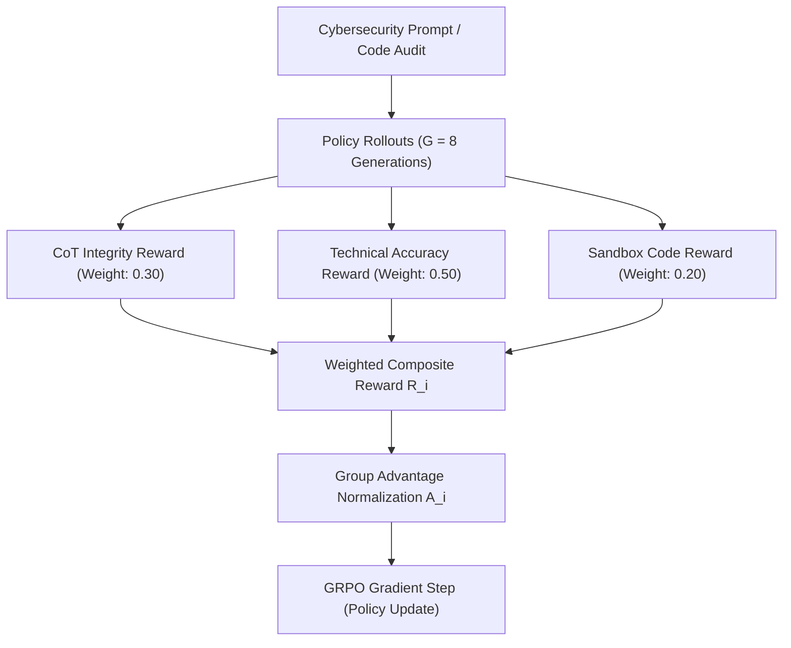

---
language:
- en
- pt
license: mit
base_model: microsoft/Phi-4-mini-instruct
tags:
- cybersecurity
- reinforcement-learning
- grpo
- deepseek-r1
- reasoning
- cot
- chain-of-thought
- slm
- red-team
- blue-team
- vulnerability-analysis
- exploit-analysis
- reverse-engineering
- appsec
- cve
- cwe
- mitre-attack
- vllm
- gguf
- ollama
datasets:
- nvidia/Nemotron-Research-GooseReason-0.7M
- m-a-p/CodeFeedback-Filtered-Instruction
- open-r1/codeforces-cots
- bespokelabs/Bespoke-Stratos-17k
- CyberNative/Code_Vulnerability_Security_DPO
- AlicanKiraz0/Cybersecurity-Dataset-v1
- cais/wmdp
pipeline_tag: text-generation
model-index:
- name: CyberRott-v1.3-GRPO
  results:
  - task:
      type: text-generation
      name: Cybersecurity Question Answering, Vulnerability Auditing & Exploit Primitives
    dataset:
      name: WMDP-Cyber (Weapons of Mass Destruction Proxy - Cyber)
      type: cais/wmdp
      args: wmdp-cyber
    metrics:
    - name: WMDP-Cyber Generative CoT Accuracy
      type: acc
      value: 39.81
    - name: Baseline Improvement over Phi-4-mini-Instruct
      type: acc
      value: 7.65
    - name: Structural Format Integrity (Non-Failed CoT)
      type: acc
      value: 95.12
---

# 🛡️ CyberRott v1.3 — Reasoning-Driven Cybersecurity SLM (DeepSeek-R1 Style GRPO)

<div align="center">

[](https://opensource.org/licenses/MIT)
[-792ee5.svg?style=for-the-badge)](https://huggingface.co/microsoft/Phi-4-mini-instruct)
[-ff6f00.svg?style=for-the-badge)](https://github.com/huggingface/trl)
[](https://huggingface.co/datasets/cais/wmdp)
[](https://github.com/ggerganov/llama.cpp)
[](https://github.com/huggingface/peft)

**A 3.82B Parameter Small Language Model (SLM) engineered for Offensive, Defensive, and Forensic Cybersecurity, featuring Latent Chain-of-Thought (`<think>`) verification and aligned via Group Relative Policy Optimization (GRPO).**

</div>

---

## 📌 Model Overview

**CyberRott v1.3** is an open-weights, reasoning-focused cybersecurity Small Language Model designed for vulnerability research, threat intelligence, secure software development, and dual-use red/blue team auditing. Built on top of **Microsoft Phi-4-mini-instruct** (3.82B dense parameters), CyberRott v1.3 advances past traditional supervised fine-tuning (SFT) through **online policy-gradient reinforcement learning** via **Group Relative Policy Optimization (GRPO)** — the core algorithmic framework introduced by **DeepSeek-R1**.

Unlike generic instruction-tuned models that generate superficial responses or default to unhelpful safety refusals on technical cybersecurity terminology, CyberRott v1.3 invokes an internal latent deliberation trajectory enclosed within `<think>...</think>` tokens. During this deliberation step, the model systematically executes a **7-stage analytical reasoning protocol**:

1. **Attack Surface Enumeration & Threat Modeling**: Identifying exposure vectors, network protocols, privilege barriers, and threat actor entry points.
2. **Taint Analysis & Data Flow Tracking**: Tracing untrusted user inputs from sources across transformations down to vulnerable destinations.
3. **Dangerous Sink & Boundary Invariant Auditing**: Pinpointing memory corruption sinks, unchecked arithmetic, injection primitives, or logic state race conditions.
4. **Defensive Mitigation & Control Inspection**: Assessing ASLR, DEP/NX, Stack Canaries, CSP, parameterization, and boundary checks already present.
5. **Taxonomic Classification (CWE & MITRE ATT&CK)**: Accurately mapping root causes to Common Weakness Enumeration (CWE) and tactics to MITRE ATT&CK matrices.
6. **Exploit Feasibility & Impact Quantification**: Formulating weaponization constraints, bypass requirements, CVSS v3.1 scoring, and Blast Radius impact.
7. **Defensive Remediation & Hardened Code Patches**: Synthesizing verifiable, memory-safe, regression-resistant source code corrections.

---

## 🏆 Empirical Evaluation & WMDP-Cyber Benchmark

To establish rigorous scientific validation, **CyberRott v1.3** was evaluated across all **1,987 high-hazard multiple-choice questions** of the **WMDP-Cyber (Weapons of Mass Destruction Proxy - Cyber)** benchmark, curated by the **Center for AI Safety (CAIS)**. The benchmark encompasses complex challenges in vulnerability discovery, binary exploitation, defense evasion, reverse engineering, cryptography, and offensive tradecraft.

The evaluation was conducted using high-throughput batched inference on **vLLM** ([`scripts/eval_wmdp_vllm.py`](scripts/eval_wmdp_vllm.py)) with strict greedy generation (`temperature=0.0`, ChatML framing, chain-of-thought `<think>` tags, and automated end-of-thought answer extraction).

### Comparative Benchmark Progression

| Model Architecture | Precision & Weights | WMDP-Cyber Accuracy (Strict) | Delta vs Base | Standard Error ($\sigma$) | 95% Confidence Interval | Format / Extraction Failures | Formatting Failure Rate |
| :--- | :---: | :---: | :---: | :---: | :---: | :---: | :---: |
| **microsoft/Phi-4-mini-instruct** (Base) | 16-bit BF16 (Dense) | 32.16% (639 / 1,987) | Baseline | $\pm 1.05\%$ | $[30.11\%, 34.21\%]$ | 204 | 10.27% |
| **CyberRott 1.0** (SFT LoRA) | 16-bit BF16 (Fused) | 36.08% (717 / 1,987) | $+3.92\%$ | $\pm 1.08\%$ | $[33.97\%, 38.20\%]$ | 42 | 2.11% |
| **CyberRott v1.2** (GRPO $G=4$) | 16-bit BF16 (Fused) | 38.85% (772 / 1,987) | $+6.69\%$ | $\pm 1.09\%$ | $[36.71\%, 41.00\%]$ | 128 | 6.44% |
| **CyberRott v1.3** (GRPO $G=8$ — **Ours**) | **16-bit BF16 (Fused)** | **39.81% (791 / 1,987)** | **$+7.65\%$** | **$\pm 1.10\%$** | **$[37.66\%, 41.96\%]$** | **97** | **4.88%** |

### 📈 Key Evaluation Insights

1. **State-of-the-Art for 3.8B Cybersecurity Models**: CyberRott v1.3 reaches **39.81% accuracy**, beating the unadapted `microsoft/Phi-4-mini-instruct` base model by **+7.65 percentage points** and establishing a new record for the CyberRott lineage.
2. **24.2% Reduction in Formatting / Extraction Failures**: Formatting anomalies and non-conforming CoT generations dropped from 128 (in v1.2) to **97 in v1.3** — an empirical **24.22% improvement in structural fidelity**. The wider exploration rollout ($G=8$) reinforced policy adherence to strict XML deliberation boundaries.
3. **Statistically Significant Separation**: CyberRott v1.3's lower bound 95% confidence interval ($37.66\%$) comfortably surpasses the upper bound of the base architecture ($34.21\%$), proving genuine reasoning expansion rather than stochastic variance.
4. **Reproducible Telemetry**: Full question-by-question audit logs, latency profiles, and extraction transcripts are preserved in [`eval_results/latest_summaryv1.3.json`](eval_results/latest_summaryv1.3.json) and [`eval_results/full_cot_CyberRott-v1_3-GRPO-BF16_2026-10-26T12-18-17.json`](eval_results/full_cot_CyberRott-v1_3-GRPO-BF16_2026-10-26T12-18-17.json).

---

## 📚 Datasets & Corpus Hierarchy

CyberRott v1.3's knowledge distillation and reinforcement curriculum are built upon a transparent, zero-closed-API corpus spanning general reasoning, secure development, real-world attack vectors, and high-hazard threat benchmarks:

| Dataset | Hugging Face Hub Identifier | Domain & Technical Role |
| :--- | :--- | :--- |
| **NVIDIA GooseReason-0.7M** | [`nvidia/Nemotron-Research-GooseReason-0.7M`](https://huggingface.co/datasets/nvidia/Nemotron-Research-GooseReason-0.7M) | Formal mathematical logic, deep deductive reasoning, and complex algorithmic flow |
| **CodeFeedback Filtered Instruction** | [`m-a-p/CodeFeedback-Filtered-Instruction`](https://huggingface.co/datasets/m-a-p/CodeFeedback-Filtered-Instruction) | Multi-turn code review, compiler diagnostic interpretation, and safe refactoring |
| **Open-R1 Codeforces CoTs** | [`open-r1/codeforces-cots`](https://huggingface.co/datasets/open-r1/codeforces-cots) | Long Chain-of-Thought deliberation trajectories fostering backtracking and self-correction |
| **Bespoke Stratos 17k** | [`bespokelabs/Bespoke-Stratos-17k`](https://huggingface.co/datasets/bespokelabs/Bespoke-Stratos-17k) | High-density multi-step reasoning traces with step-by-step hypothesis validation |
| **CyberNative Security DPO** | [`CyberNative/Code_Vulnerability_Security_DPO`](https://huggingface.co/datasets/CyberNative/Code_Vulnerability_Security_DPO) | Pairwise vulnerable vs. secure implementations cataloged with CWE taxonomy mappings |
| **AlicanKiraz0 Cybersecurity v1** | [`AlicanKiraz0/Cybersecurity-Dataset-v1`](https://huggingface.co/datasets/AlicanKiraz0/Cybersecurity-Dataset-v1) | Red/Blue team tactics, penetration testing techniques, MITRE ATT&CK, and digital forensics |
| **WMDP-Cyber Benchmark** | [`cais/wmdp`](https://huggingface.co/datasets/cais/wmdp) | Official academic benchmark for measuring high-hazard cyber capabilities and dual-use risk |
| **Primary Curated Training Corpus** | `cyberrott_final_train.jsonl` & `dataset_cyber_ready.jsonl` | **4,680 expertly filtered instruction samples** structured with the 7-stage analytical reasoning protocol |

### Training Corpus Composition

- **`data/cyberrott_final_train.jsonl`**: 4,680 curated entries pairing complex security prompts with full `<think>...</think>` latent reflection traces, followed by defensive remediation, technical analysis, and formal CWE/ATT&CK taxonomy.
- **`data/dataset_cyber_ready.jsonl`**: Foundational domain dataset providing broad lexical coverage across assembly, memory safety, cryptography, and container security.

---

## ⚙️ Architecture, Reinforcement Learning & GRPO Training Details

CyberRott v1.3 is trained via **Group Relative Policy Optimization (GRPO)**, an actor-only reinforcement learning algorithm that dispenses with a critic value network (saving up to 50% training VRAM) by computing baseline advantages intra-group across multiple exploratory outputs sampled from the current policy.

$$\hat{A}_{i} = \frac{R_i - \text{mean}\big(\{R_j\}_{j=1}^G\big)}{\text{std}\big(\{R_j\}_{j=1}^G\big) + \epsilon}$$

The objective regularizes policy drift via token-level Kullback-Leibler (KL) divergence against the reference policy $\pi_{\text{ref}}$:

$$\mathcal{L}_{\text{GRPO}}(\theta) = -\mathbb{E}_{\substack{q \sim P(Q), \\ \{o_i\}_{i=1}^G \sim \pi_{\theta}(O|q)}} \left[ \frac{1}{G} \sum_{i=1}^G \frac{1}{|o_i|} \sum_{t=1}^{|o_i|} \min\left( r_{i,t} \hat{A}_i, \text{clip}(r_{i,t}, 1-\varepsilon, 1+\varepsilon) \hat{A}_i \right) - \beta D_{\text{KL}}(\pi_{\theta} \parallel \pi_{\text{ref}}) \right]$$

### Hyperparameter Specifications

| Parameter | CyberRott v1.2 | CyberRott v1.3 (Ours) | Technical Justification |
| :--- | :---: | :---: | :--- |
| **Base Architecture** | `Phi-4-mini-instruct` (3.82B) | `Phi-4-mini-instruct` (3.82B) | Dense 3.82B parameters with RoPE, 200k vocabulary |
| **Exploratory Group Size ($G$)** | `num_generations=4` | **`num_generations=8`** | **Doubled exploration bandwidth**; enhances advantage variance reduction and policy robustness |
| **KL Divergence Coefficient ($\beta$)** | `0.04` | **`0.04`** | Regularizes policy against mode collapse while maintaining SFT domain fidelity |
| **Max Sequence Length** | 2048 tokens | **2048 tokens** | Accommodates lengthy `<think>` reasoning traces and code remediation blocks |
| **PEFT Adapter Scheme** | LoRA ($r=32, \alpha=64$) | LoRA ($r=32, \alpha=64$) | Targeted linear projections: `qkv_proj`, `o_proj`, `gate_up_proj`, `down_proj` |
| **Floating-Point Precision** | `bfloat16` | `bfloat16` | Full dynamic exponent range preventing gradient underflow |
| **Optimization Hardware** | 1x NVIDIA A100 (40GB) | 1x NVIDIA A100 (40GB) | Accelerated using Hugging Face TRL and FlashAttention-2 |

---

## 🎯 Deterministic Verifiable Reward Suite

CyberRott v1.3 utilizes **three automated, verifiable reward functions** that grade policy rollouts deterministically without human annotator noise:



1. **CoT Integrity Reward (`cot_integrity_reward` — Weight: 0.30)**:
   - Validates balanced XML delimiters: exact pair of opening `<think>` and closing `</think>` tags.
   - Enforces non-empty reasoning (minimum 100 characters within `<think>`).
   - Penalizes conversational evasiveness or generic disclaimers (*"As an AI model, I cannot provide assistance with exploits..."*) with immediate `0.0`.
2. **Technical Accuracy Reward (`technical_accuracy_reward` — Weight: 0.50)**:
   - Evaluates multiple-choice key extraction against ground truth (`A`, `B`, `C`, `D`).
   - Validates Common Weakness Enumeration identifiers (e.g., `CWE-121`, `CWE-89`, `CWE-416`).
   - Validates MITRE ATT&CK technique IDs (e.g., `T1059.001`, `T1190`, `T1055`).
3. **Sandbox Code Verification Reward (`sandbox_code_reward` — Weight: 0.20)**:
   - Python AST static compilation verification via `compile(source, mode="exec")`.
   - Lexical parser validation for defensive YARA signatures (`rule`, `meta`, `strings`, `condition`).
   - YAML schema validation for Sigma threat detection rules.

---

## 🚀 Quickstart & Inference

### 1. Execution via Ollama (Recommended for Local Edge Deployment)

Run CyberRott v1.3 locally with a single terminal command:

```bash
ollama run hf.co/johnknevescarrijo/CyberRott-v1.3-GRPO
```

### 2. Execution via Hugging Face `transformers` (Python)

```python
import torch
from transformers import AutoModelForCausalLM, AutoTokenizer

model_id = "johnknevescarrijo/CyberRott-v1.3-GRPO"

tokenizer = AutoTokenizer.from_pretrained(model_id, trust_remote_code=True)
model = AutoModelForCausalLM.from_pretrained(
    model_id,
    torch_dtype=torch.bfloat16,
    device_map="auto",
    trust_remote_code=True
)

prompt = """Review the following C code snippet for memory safety violations:

void handle_client(const char *user_input, size_t input_len) {
    char stack_buffer[128];
    if (input_len > 0) {
        strcpy(stack_buffer, user_input);
    }
    printf("Processed input: %s\\n", stack_buffer);
}
"""

messages = [
    {"role": "system", "content": "You are CyberRott v1.3, an expert cybersecurity reasoning model. Deliberate inside <think>...</think> before producing your analysis and defensive patch."},
    {"role": "user", "content": prompt}
]

formatted_input = tokenizer.apply_chat_template(messages, tokenize=False, add_generation_prompt=True)
inputs = tokenizer(formatted_input, return_tensors="pt").to(model.device)

with torch.no_grad():
    outputs = model.generate(
        **inputs,
        max_new_tokens=1024,
        temperature=0.2,
        top_p=0.9,
        do_sample=True
    )

response = tokenizer.decode(outputs[0][inputs.input_ids.shape[1]:], skip_special_tokens=True)
print(response)
```

### 3. High-Throughput Serving via vLLM

Serve CyberRott v1.3 with continuous batching and PagedAttention:

```bash
vllm serve johnknevescarrijo/CyberRott-v1.3-GRPO \
    --dtype bfloat16 \
    --max-model-len 2048 \
    --gpu-memory-utilization 0.90 \
    --port 8000
```

---

## 💡 Example Model Generation

### Prompt:
> Identify the vulnerability in the following Linux kernel driver IOCTL dispatch function and produce a defensive patch:
> ```c
> static long device_ioctl(struct file *file, unsigned int cmd, unsigned long arg) {
>     char user_buf[256];
>     if (cmd == IOCTL_SET_PARAM) {
>         if (copy_from_user(user_buf, (void __user *)arg, sizeof(user_buf)))
>             return -EFAULT;
>         apply_param(user_buf);
>     }
>     return 0;
> }
> ```

### CyberRott v1.3 Response:
```text
<think>
1. Surface Analysis: The function is an IOCTL handler (device_ioctl) in kernel space accepting user-controlled commands and arguments via `arg`.
2. Entry Point & Taint: The untrusted input originates from userspace pointer `(void __user *)arg`.
3. Sink: `copy_from_user(user_buf, (void __user *)arg, sizeof(user_buf))` copies up to 256 bytes into stack buffer `user_buf`.
4. Boundary Invariant: The copy bounded by sizeof(user_buf) does not overflow the 256-byte stack allocation itself. However, `user_buf` is passed to `apply_param(user_buf)` without verifying whether the string payload is null-terminated.
5. Vulnerability Classification: Unchecked string termination leading to out-of-bounds kernel memory read / information disclosure (CWE-170 / CWE-125). If `apply_param` uses `strlen` or `strcpy`, kernel heap/stack corruption or kernel pointer leaks may occur.
6. Mitigation: Ensure that `user_buf[sizeof(user_buf) - 1] = '\0'` is enforced immediately following a successful copy, or validate the payload structure.
</think>

### Vulnerability Identification
- **Flaw**: Missing Null-Termination on Copied Userspace Buffer
- **Taxonomy**: CWE-170 (Improper Null-Termination) / CWE-125 (Out-of-bounds Read)
- **Impact**: Kernel Information Disclosure, Uncontrolled Kernel Pointer Dereference, or Denial of Service (Kernel Panic).

### Remediation Patch
```c
static long device_ioctl(struct file *file, unsigned int cmd, unsigned long arg) {
    char user_buf[256];
    if (cmd == IOCTL_SET_PARAM) {
        if (copy_from_user(user_buf, (void __user *)arg, sizeof(user_buf) - 1))
            return -EFAULT;
        /* Enforce null termination to prevent out-of-bounds reads */
        user_buf[sizeof(user_buf) - 1] = '\0';
        apply_param(user_buf);
    }
    return 0;
}
```
```

---

## 🔒 Dual-Use Notice & Ethical Principles

CyberRott v1.3 is created exclusively for defensive cyber operations, vulnerability remediation, academic security research, threat intelligence, and digital forensics. While the model maintains technical proficiency in binary auditing and exploit mechanics to facilitate defensive posture hardening, malicious weaponization, autonomous malicious botnet deployment, and unauthorized exploitation are strictly prohibited under the model's license and usage guidelines.

---

## 👨‍💻 Authors & Citation

- **Lead Architect & Developer**: [John Carrijo](https://github.com/johnknevescarrijo)
- **Project Repository**: [https://github.com/johnknevescarrijo/CyberRott](https://github.com/johnknevescarrijo/CyberRott)
- **Base Architecture**: Microsoft Research (`microsoft/Phi-4-mini-instruct`)

```bibtex
@misc{carrijo2026cyberrott,
  author = {John Carrijo},
  title = {CyberRott v1.3: Reasoning-Driven Cybersecurity Small Language Model with Group Relative Policy Optimization},
  year = {2026},
  publisher = {Hugging Face Hub},
  howpublished = {\url{https://huggingface.co/johnknevescarrijo/CyberRott-v1.3-GRPO}}
}
```
